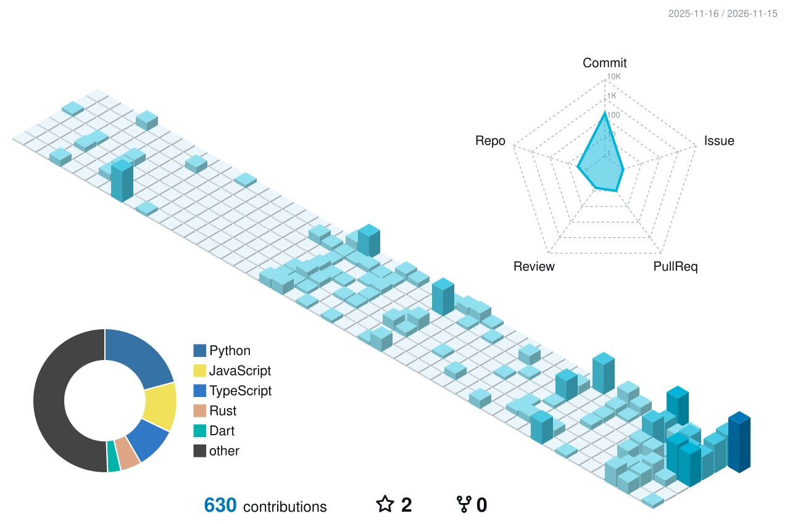

<div align="center">

# Hi, I'm Jakub 👋

### Full Stack & IoT Engineer — Python · React · Rust · AI


<a href="https://jakubjakubiak.com"></a>
<a href="https://www.linkedin.com/in/jakub-jakubiak-793213174/"></a>
<a href="https://github.com/JakubJakubiak?tab=followers"></a>

</div>

---

## 🧑‍💻 About me

I build complete systems end-to-end — **mobile and web apps, backends, databases and the servers they run on**.
Lately: AI-powered mobile apps, IoT with real-time data, and interactive scenes in Unreal Engine.

---

## ⚙️ Core Stack

### 💻 Languages

<p>
  <a href="https://www.python.org" title="Python – Programming Language"></a> 
  <a href="https://www.typescriptlang.org" title="TypeScript – Typed JavaScript"></a> 
  <a href="https://developer.mozilla.org/en-US/docs/Web/JavaScript" title="JavaScript – Programming Language"></a> 
  <a href="https://dart.dev" title="Dart – Programming Language"></a>
  <a href="https://www.rust-lang.org" title="Rust – Systems Programming Language"></a></p>


### 🎨 Frontend & Mobile

<p align="">
  <a href="https://react.dev" title="React – Frontend Library"></a>
  <a href="https://nextjs.org" title="Next.js – React Framework"></a>
  <a href="https://redux.js.org" title="Redux – State Management"></a>
  <a href="https://tailwindcss.com" title="Tailwind CSS – Utility-First CSS Framework"></a>
  <a href="https://vite.dev" title="Vite – Frontend Build Tool"></a>
  <a href="https://flutter.dev" title="Flutter – Cross-Platform UI Framework"></a>
</p>

### 🧠 Backend & AI

<p align="">
  <a href="https://nodejs.org" title="Node.js – JavaScript Runtime"></a>
  <a href="https://www.python.org" title="Python – Backend Development"></a>
  <a href="https://pytorch.org" title="PyTorch – Machine Learning Framework"></a>
  <a href="https://firebase.google.com" title="Firebase – Backend & Cloud Platform"></a>
</p>

### 🗄️ Databases & Data

<p align="">
  <a href="https://www.postgresql.org" title="PostgreSQL – Relational Database"></a>
  <a href="https://www.mysql.com" title="MySQL – Relational Database"></a>
  <a href="https://www.mongodb.com" title="MongoDB – NoSQL Database"></a>
  <a href="https://firebase.google.com" title="Firebase – Cloud Database & Backend"></a>
</p>

**Also:** InfluxDB • SQL • Time-series data • REST APIs

### 🏗️ Infrastructure & IoT

<p align="">
  <a href="https://www.docker.com" title="Docker – Containerization"></a>
  <a href="https://www.linux.org" title="Linux – Operating System"></a>
  <a href="https://www.raspberrypi.com" title="Raspberry Pi – Single-Board Computer"></a>
  <a href="https://www.cloudflare.com" title="Cloudflare – Web Infrastructure & Security"></a>
  <a href="https://cloud.google.com" title="Google Cloud – Cloud Platform"></a>
  <a href="https://aws.amazon.com" title="AWS – Cloud Platform"></a>
</p>

**Also:** MQTT • OVHcloud • VPS • Physical servers • Server configuration • Real-time synchronization

### 🛠️ Tools

<p align="">
  <a href="https://github.com" title="GitHub – Code Hosting & Version Control"></a>
  <a href="https://git-scm.com" title="Git – Version Control"></a>
  <a href="https://code.visualstudio.com" title="Visual Studio Code – Code Editor"></a>
  <a href="https://www.jetbrains.com/webstorm" title="WebStorm – JetBrains IDE"></a>
  <a href="https://developer.android.com/studio" title="Android Studio – Android IDE"></a>
  <a href="https://pnpm.io" title="pnpm – Fast JavaScript Package Manager"></a>
</p>

---


## 🔧 What I Work On

```text
Frontend
  ├─ React
  ├─ Next.js
  └─ React Native / Flutter

Backend
  ├─ Python
  ├─ Node.js
  └─ REST APIs

Data
  ├─ PostgreSQL / MySQL
  ├─ Firebase
  └─ InfluxDB

Infrastructure
  ├─ Docker
  ├─ Linux
  ├─ OVHcloud
  └─ Physical Servers

IoT
  ├─ MQTT
  ├─ Raspberry Pi
  └─ Real-time data synchronization

AI
  ├─ LLM APIs
  ├─ AI applications
  └─ Automation
```

---

## 🔨 Now building

- **[streammatch](https://github.com/JakubJakubiak/streammatch)** — Tinder-style app for Twitch streamers (React Native + Convex, Twitch login, realtime chat)
- **[sakura-river-unreal](https://github.com/JakubJakubiak/sakura-river-unreal)** — interactive stream background in Unreal Engine 5 (Nanite Foliage, Lumen)

---

## 📱 Apps on Google Play

<p align="center">
  
</p>

| App | What it does | |
|---|---|---|
| 🤖 **Human or AI** | Guess whether content was made by a human or AI | [](https://play.google.com/store/apps/details?id=inu.night.humanAI) |
| 🌱 **Plant Identifier: AI Scanner** | Identify plants from a photo, care tips, watering schedule | [](https://play.google.com/store/apps/details?id=com.inu.plantsai) |
| 💬 **MyMultimind** | AI chat bot | [](https://play.google.com/store/apps/details?id=com.night.multimindbot) |
| ✍️ **Caption for Social Media AI** | AI captions and hashtags for posts | [](https://play.google.com/store/apps/details?id=com.inu.hashtaggenerator) |

---

## 📈 Activity

<div align="center">
  <picture>
    <source media="(prefers-color-scheme: dark)" srcset="./profile-3d-contrib/profile-dark.svg" />
    <source media="(prefers-color-scheme: light)" srcset="./profile-3d-contrib/profile-light.svg" />
    
  </picture>
</div>

<div align="center">

**Build. Deploy. Optimize.** ⚡

</div>
